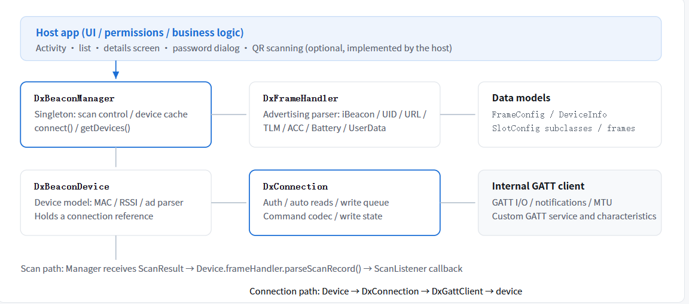
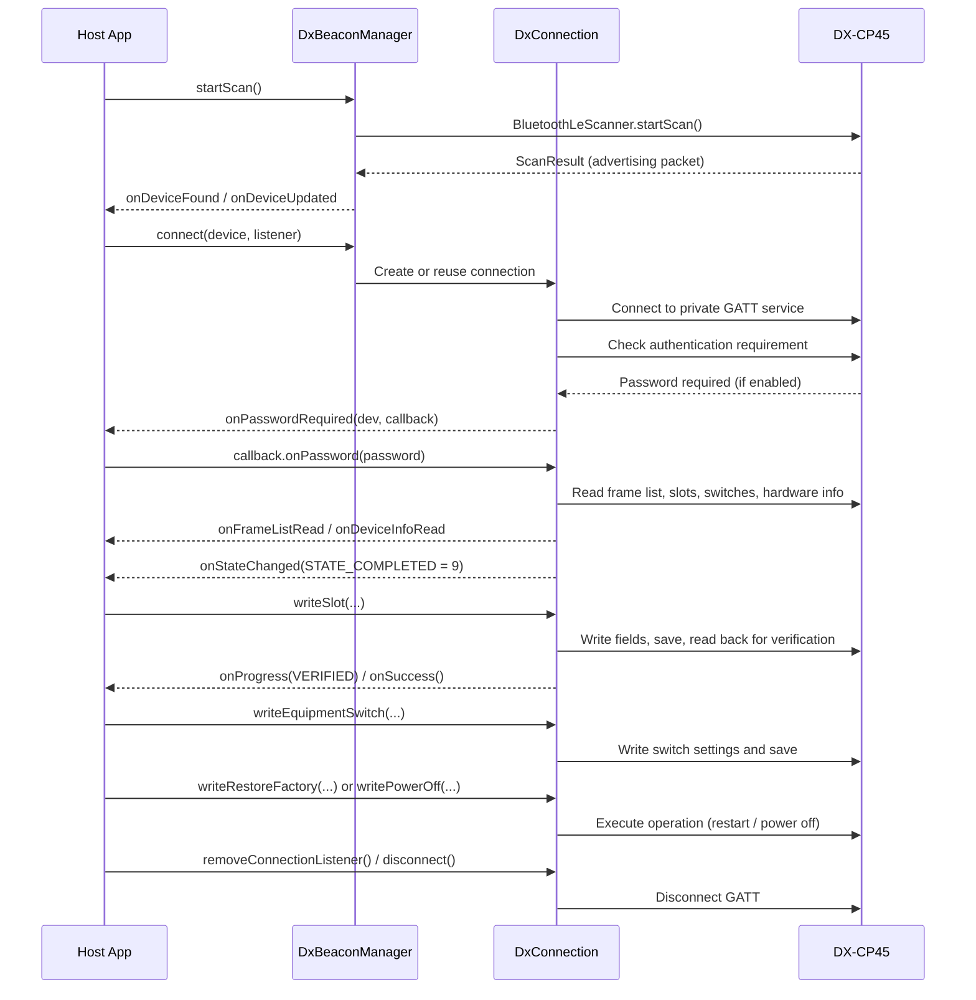

## DxBeacon SDK Integration Guide
> Android SDK Integration Guide · v1.0.0
An .aar integration guide for Android developers, covering project setup, permissions, scanning, connection and authentication, configuration reads and writes, call flows, and sample code.

**Package:** `ibeaconsdk-release.aar`  
**Version:** V1.0  
**minSdk:** 25  
**compileSdk:** 32  
**Java:** 8  
**Protocol:** Proprietary BLE protocol

### 📦 Downloads & Resources

| Resource Name | File | Version | Description | Download |
| :--- | :--- | :--- | :--- | :--- |
| **Android SDK Library** | `ibeaconsdk-release.aar` | `v1.0.0` | Core `.aar` library for integration into your own Android project. | [Download SDK](https://github.com/ConkMile/dxibeacon-v1.1/releases/download/DxBeacon-SDK-v1.0.0/ibeaconsdk-release.aar) |
| **Client Demo Source** | `DXibeaconsdk_Demo.rar` | `v1.0.0` | Minimal Android Studio test project for quick evaluation and verification. | [Download Demo](https://github.com/ConkMile/dxibeacon-v1.1/releases/download/DXibeaconSDK-Demo/DXibeaconSDK_Demo.rar) |

## Documentation Overview

DxBeacon SDK is a BLE advertising-device discovery and configuration library for managing and configuring DX-CP45 devices. The host app is responsible for the UI and user interactions. The SDK handles advertising-data parsing, connection authentication, parameter read/write operations, and protocol-frame encoding and decoding.

Recommended reading order: Review the architecture and the two operating phases in Chapter 1 → complete project integration in Chapters 2–4 → run the basic workflow in Chapter 5 → refer to the APIs in Chapters 6–12 as needed → review thread and write-operation constraints in Chapter 15.


## 1. Design Overview

### 1.1 Overall Architecture

The SDK uses a three-layer architecture: Manager → Device → Connection. Advertising-data parsing and protocol connections are independent. During scanning, the SDK only parses advertising packets and does not establish a connection. During the connection phase, each connection object exclusively manages one GATT link.


*Figure 1. SDK layers and two independent paths (advertising-data parsing / protocol connection)*

### 1.2 Advertising Phase

During scanning, the SDK performs two operations for each `ScanResult`:

- **Parse advertising data**: `DxFrameHandler.parseScanRecord()` parses iBeacon, Eddystone UID/URL/TLM, ACC, UserData, and battery data. The results are stored as `DxFrame` subclasses in `device.frameHandler` and can be retrieved by `FrameType`.
- **Cache devices**: Devices are deduplicated by MAC address. The SDK updates `rssi` and `lastUpdate`, then notifies the host app through `ScanListener`: `onDeviceFound` is called when a device is discovered for the first time, and `onDeviceUpdated` is called for subsequent updates.

### 1.3 Connection Phase

The SDK automatically performs the following connection workflow: authentication → reading → ready. The host app only needs to listen for state changes:

1. **Establish the connection**：Connect to the private GATT service and enable notifications on the response characteristic.
2. **Password authentication**: The SDK first checks whether a password is required. If so, it invokes `onPasswordRequired`. The host app prompts the user and returns the password through `OnPasswordCallback.onPassword()`. The SDK continues after successful verification.
3. **Automatic reading**：The SDK reads the frame list, each slot's frame, equipment-switch settings, and hardware information in sequence.
4. **Ready**: When reading is complete, the SDK reports `STATE_COMPLETED (9)`. The data has been delivered through `onFrameListRead` and `onDeviceInfoRead`.

## 2. Development Environment

| Item | Requirement |
| --- | --- |
| Build tools | Android Gradle Plugin 7.0+，Gradle 7.x |
| minSdkVersion | 25 (Android 7.1) or later |
| compileSdkVersion | 32 or later (the host app may use a higher version) |
| Java version | Java 8（`sourceCompatibility 1.8`） |
| Dependencies | No additional third-party libraries are required. Using AndroidX in the host app is recommended. |
| Hardware | BLE support (Bluetooth 4.0 or later) |

## 3. Import the AAR

The SDK is distributed as a single file, `ibeaconsdk-release.aar`. Import it manually into the target Android Studio project:

### Method: Reference the AAR Directly from `files`

```groovy
dependencies {
    implementation files('libs/ibeaconsdk-release.aar')
}
```

## 4. Request Permissions

The AAR's `AndroidManifest.xml` already declares the permissions listed below, so the host app does not need to declare them again. However, the permissions must still be requested at runtime:

| Permission | Applicable Android version | Purpose |
| --- | --- | --- |
| `BLUETOOTH_SCAN` | Android 12 (API 31)+ | Scan for advertising packets |
| `BLUETOOTH_CONNECT` | Android 12 (API 31)+ | Connect to devices and read device names |
| `ACCESS_FINE_LOCATION` | Android 11 and earlier | Required by the system for BLE scanning |
| `BLUETOOTH` / `BLUETOOTH_ADMIN` | Android 11 and earlier | Classic Bluetooth compatibility |

```java
// Request runtime permissions in the host Activity
String[] need;
if (Build.VERSION.SDK_INT >= Build.VERSION_CODES.S) {
    need = new String[]{
            Manifest.permission.BLUETOOTH_SCAN,
            Manifest.permission.BLUETOOTH_CONNECT
    };
} else {
    need = new String[]{ Manifest.permission.ACCESS_FINE_LOCATION };
}
ActivityCompat.requestPermissions(this, need, 1001);
```

## 5. Quick Start

### 5.1 Initialize and Start Scanning

```java
// Singleton instance that internally holds the Application Context
DxBeaconManager manager = DxBeaconManager.getInstance(getApplicationContext());

// Get the SDK version (currently V1.0) for logging or display on the About page
String sdkVersion = DxBeaconManager.getSdkVersion();      // "V1.0"
int sdkVersionCode = DxBeaconManager.getSdkVersionCode(); // 1

// Optional filters: device name keyword, MAC address prefix, and minimum RSSI
manager.setScanFilter(null, null, -100);

manager.setScanListener(new ScanListener() {
    @Override public void onDeviceFound(DxBeaconDevice device) {
        // Add the device to the list when first discovered
    }
    @Override public void onDeviceUpdated(DxBeaconDevice device) {
        // Update the list item when RSSI or advertising data changes
    }
    @Override public void onScanFailed(int errorCode) { }
    @Override public void onScanStopped() { }
});

if (!manager.isBluetoothEnabled()) {
    // Prompt the user to enable Bluetooth: startActivity(new Intent(BluetoothAdapter.ACTION_REQUEST_ENABLE))
    return;
}
manager.startScan();
```

### 5.2 Connect to a Device

```java
manager.connect(device, new ConnectionListener() {

    @Override
    public void onStateChanged(DxBeaconDevice dev, int state) {
        // See Section 9.1 for state codes; 9 = automatic reading completed
    }

    @Override
    public void onPasswordRequired(DxBeaconDevice dev, OnPasswordCallback callback) {
        // Note: This callback runs on the BLE callback thread. Switch to the main thread for UI operations.
        runOnUiThread(() -> showPasswordDialog(callback));
    }

    @Override
    public void onFrameListRead(DxBeaconDevice dev, FrameConfig[] frames) {
        // frames[0..6] correspond to slot indexes 0..6
    }

    @Override
    public void onDeviceInfoRead(DxBeaconDevice dev, DeviceInfo info) {
        // info.batteryMv / mac / firmwareVersion ...
    }

    @Override
    public void onCommandResponse(DxBeaconDevice dev, int cmd, byte[] payload) { }

    @Override
    public void onError(DxBeaconDevice dev, int errorCode, String message) { }
});
```

### 5.3 Prompt the User for a Password if the Device Requires One

```java
private void showPasswordDialog(OnPasswordCallback callback) {
    // Simple example: use a custom-layout AlertDialog in a production app.
    EditText input = new EditText(this);
    new AlertDialog.Builder(this)
            .setTitle("Device Password")
            .setView(input)
            .setCancelable(false)
            .setPositiveButton("OK", (d, w) -> callback.onPassword(input.getText().toString().trim()))
            .show();
}
```

### 5.4 Display the Current Configuration of Each Slot After a Successful Read

After the connection is established and automatic reading is complete (`onStateChanged` receives `STATE_COMPLETED`), the configurations for all seven slots are cached in `connection.frames`. Retrieve them directly to render the list; no additional read commands are required.

```java
// A common approach is to refresh whenever a read result is received:
// Refresh once in onFrameListRead, then refresh again as a fallback in STATE_COMPLETED.
@Override
public void onFrameListRead(DxBeaconDevice dev, FrameConfig[] frames) {
    runOnUiThread(() -> renderSlots(frames));
}

private void renderSlots(FrameConfig[] frames) {
    if (frames == null) return;

    for (int i = 0; i < frames.length; i++) {
        FrameConfig fc = frames[i];
        if (fc == null) continue;

        // Display slot numbers starting from 1: Slot 1 to Slot 7
        String slotTitle = "Slot " + (fc.slotIndex + 1);

        // For a disabled slot, frameType = FRAME_TYPE_EMPTY(0xFF) and slotName = "NoData".
        String typeName = fc.isEnabled() ? fc.getSlotName() : "NoData";

        // Trigger parameters: triggerType and triggerTime are both 0 when the trigger is off.
        String trigger = fc.triggerOn
                ? triggerTypeName(fc.triggerType) + " / " + fc.triggerTime + "s"
                : "off";

        // Specific fields (UUID / Major / Minor / advertising interval / transmit power, etc.) are in fc.rawData.
        // Parse according to the frame type; see demo SlotEditActivity.parseRawData() for the parsing logic.
        Log.d("Slot", slotTitle + " | " + typeName + " | trigger=" + trigger);

        // Add each row to the list adapter (the demo reads the same fields in SlotAdapter.getView).
        slotAdapter.addRow(slotTitle, typeName, trigger);
    }
    slotAdapter.notifyDataSetChanged();
}

private String triggerTypeName(int triggerType) {
    switch (triggerType) {
        case 1:  return "Double click";
        case 2:  return "Triple click";
        case 3:  return "Device move";
        default: return "-";
    }
}
```

- **Array index is the slot**: `frames[0]` through `frames[6]` correspond to Slot 1 through Slot 7, regardless of frame type. Any slot can contain any frame type.
- **Check whether a slot is enabled**: Use `isEnabled()` (internally, `frameType != FRAME_TYPE_EMPTY`). Do not use `rawData == null` for this check.
- **Detailed parameters**: `rawData` contains the configuration data returned by the device. Field offsets vary by frame type, so parse it as needed. To display an overview only, use `getSlotName()`.
- **Refresh after modification**: After a slot is written successfully, `writeSlot` updates that slot's `rawData`. Call the rendering method again to refresh the UI.

### 5.5 Write and Save the Configuration

```java
// 1. Build the configuration object. Its fields are public and can be assigned directly (as in demo SlotEditActivity).
IBeaconSlotConfig c = new IBeaconSlotConfig();
c.proximityUuid = "E2C56DB5DFFB48D2B060D0F5A71096E0";
c.major = 1;
c.minor = 2;
c.distanceTxPower = -59;
c.advInterval = SlotConfig.advIntervalMsToRaw(200);  // milliseconds -> raw value 1..15
c.txPower = SlotConfig.clampTxPower(3);              // 0..7

// 2. Validate first. A return value of null indicates valid input.
String err = c.validate();
if (err != null) { toast(err); return; }

// 3. Write. The SDK automatically writes the fields -> saves the configuration -> reads it back for verification.
// Parameters: slot index 0..6, configuration, trigger switch, trigger type (1=double-click, 2=triple-click, 3=movement), and trigger duration 0..100 seconds.
connection.writeSlot(0, c, false, 0, 0, new DxWriteCallback() {
    @Override public void onProgress(WriteStage stage) { // FRAME_WRITTEN → CONFIG_SAVED → VERIFIED }
    @Override public void onSuccess() { // Successfully persisted and verified. }
    @Override public void onError(int Code, String message) { }
});
```

### 5.6 Equipment Switches / Factory Reset / Power Off

```java
// Equipment switches: 3 bytes, corresponding to the three switches in the settings dialog; 1=ON, 0=OFF.
// Internally performs 'write settings -> save'. On success, the local connection.equipmentSwitch cache is updated.
byte[] sw = new byte[]{1, 0, 0};
connection.writeEquipmentSwitch(sw, new DxOperationCallback() {
    @Override public void onSuccess() { }
    @Override public void onError(int Code, String message) { } // -107 = the device rejected this combination
});

// Factory reset: the device restarts after success. The host app should disconnect manually and return to the scanning screen.
connection.writeRestoreFactory(new DxOperationCallback() {
    @Override public void onSuccess() {
        connection.removeConnectionListener(stateListener); // Avoid an unintended disconnection notification.
        connection.disconnect();
        finish();
    }
    @Override public void onError(int Code, String message) { }
});

// Power off: the device will shut down after success. Disconnect manually and return to the scanning screen.
connection.writePowerOff(new DxOperationCallback() {
    @Override public void onSuccess() {
        connection.removeConnectionListener(stateListener);
        connection.disconnect();
        finish();
    }
    @Override public void onError(int Code, String message) { }
});
```

## 6. DxBeaconManager

A global singleton responsible for scanning, device caching, and initiating connections.

| Method | Description |
| --- | --- |
| `getInstance(Context)` | Gets the singleton instance. Passing the Application Context is recommended. |
| `getSdkVersion()` | Static method that returns the SDK version string. The current version is `"V1.0"`. |
| `getSdkVersionCode()` | Static method that returns the SDK version code as an integer for version comparisons. The current value is `1`. |
| `isBluetoothEnabled()` | Checks whether Bluetooth is enabled. |
| `getBluetoothState()` | Returns the raw Bluetooth adapter state. |
| `setScanFilter(String name, String macPrefix, int minRssi)` | Sets scan filters. A value of `null` disables the corresponding filter; for example, `minRssi` can be `-100`. |
| `setScanListener(ScanListener)` | Sets the scan listener. |
| `startScan()` / `stopScan()` | Starts / stops scanning. |
| `isScanning()` | Checks whether scanning is currently active. |
| `getDevices()` | Returns a snapshot of the device list (thread-safe; can be called from the main thread). |
| `clear()` | Clears the cached device list. |
| `connect(DxBeaconDevice, ConnectionListener)` | Connects to a device. Scanning is stopped first; the existing connection is reused or recreated as needed. |
| `disconnect(DxBeaconDevice)` | Disconnects the specified device. |
| `setUUIDConfig(BeaconUUIDConfig)` | Replaces the service/characteristic UUID configuration (supports DEFAULT / LEGACY / NUS). |
| `getUUIDConfig()` | Gets the current UUID configuration. |

## 7. DxBeaconDevice

The device model is created and cached by the SDK during scanning. After connection, it holds a `connection` reference.

| Member | Type | Description |
| --- | --- | --- |
| `macAddress` | String | MAC address |
| `name` | String | Device name parsed from the advertising data (may be `null`). |
| `rssi` | int | Latest signal strength. |
| `lastUpdate` | long | Timestamp of the most recent scan result. |
| `dxBeacon` | boolean | Indicates whether this is a DX-SMART device (private Service UUID). |
| `frameHandler` | DxFrameHandler | Container for parsed advertising data. |
| `connection` | DxConnection | Connection object (non-null after connection). |
| `androidDevice` | BluetoothDevice | Native Android object; can be used in scenarios that require `getRemoteDevice`. |
| `isConnected()` | boolean | Indicates whether the device is connected. |
| `getConnectionState()` | int | `-1` indicates that no connection has been established. |

## 8. DxConnection

Provides all operation entry points for a GATT connection. All write methods are executed serially in `writeMode`. A repeated call while a write is in progress returns `-4`.

### 8.1 Connection and State

| Method | Description |
| --- | --- |
| `connect(ConnectionListener)` | Establishes the connection and starts the automatic authentication/reading workflow. |
| `disconnect()` | Disconnects the connection. |
| `isConnected()` | Indicates whether the device is connected. |
| `getState()` | Returns the current state Code (see Section 9.1). |
| `addConnectionListener(l)` / `removeConnectionListener(l)` | Adds or removes a connection-state listener. Remove the listener before disconnecting manually to avoid an unintended disconnection notification. |

### 8.2 Read Operations

| Method | Description |
| --- | --- |
| `readFramesWithDetails(DxOperationCallback)` | Reads the frame list and the raw frames for each slot. Calls `onFrameListRead` when complete. |
| `readDeviceInfo()` | Reads hardware information and calls `onDeviceInfoRead` when complete. |
| `readFrames()` | Reads only the frame list. |
| `readEquipmentSwitch()` | Reads the equipment-switch settings. |
| `readPwdRequired()` | Checks whether a connection password is required. Returns an integer (`1` = required); the result is also reported through `onCommandResponse`. |
| `readAllParams()` | Reads all parameters. |

### 8.3 Write Operations

| Method | Description |
| --- | --- |
| `writeSlot(int slotIndex, SlotConfig config, boolean triggerOn, int triggerType, int triggerTime, DxWriteCallback callback)` | **Recommended:** Writes the slot configuration, including trigger settings. The SDK automatically saves the configuration and reads it back for verification. |
| `writeSlot(int slotIndex, SlotConfig config, DxWriteCallback callback)` | Simplified overload: equivalent to `triggerOn=false`, `triggerType=0`, and `triggerTime=0`. |
| `writeSlotTrigger(int slot, boolean on, int type, int time, DxOperationCallback)` | Updates only the slot trigger; frame data is not modified. |
| `writeSlotFrame(int slot, SlotConfig, DxOperationCallback)` | Writes only the frame fields without saving. This is an advanced operation; `writeSlot` is recommended for general use. |
| `writeDisableSlot(int slot, DxWriteCallback)` | Disables the slot. |
| `writeSaveConfig(DxOperationCallback)` | Saves the configuration to Flash. |
| `writeEquipmentSwitch(byte[3], DxOperationCallback)` | Equipment switches: **writes the settings and then saves them** in a single call. |
| `writeChangePassword(String, DxOperationCallback)` | Changes the connection password. The password must contain 6 ASCII characters; writing and saving are handled internally. |
| `writeRestoreFactory(DxOperationCallback)` | Restores factory settings. The device restarts after a successful operation. |
| `writePowerOff(DxOperationCallback)` | Powers off the device. The device shuts down after a successful operation. |
| `writeTrigger(boolean on, int type, int time, DxOperationCallback)` | Triggers advertising globally. |
| `setDeviceName / setAdvInterval / setTxPower / setEquipmentSwitch` | Individual setting methods (applied immediately but not saved). Call `writeSaveConfig` separately to persist the changes. The corresponding combined `write*` methods are generally recommended. |
| `selectFrame(int slotIndex)` | Selects the target slot for the current write operation. The write queue calls this method automatically. |
| `sendRawCommand(byte[] rawFrame)` | Passes through a raw protocol frame (advanced use; byte-level details are outside the scope of this document). |

> **写入约束**
> Write operations are handled by a **serial queue**. Until the current write operation is complete, including the ACK for its final command, any new write request immediately returns `-4`. Do not call multiple write methods consecutively from a button-click handler. Use a combined entry point such as `writeSlot()`, or chain the next operation from `onSuccess`.

## 9. Listeners

### 9.1 ConnectionListener State Codes

All state constants are defined in the public `DxConnection` class (`STATE_DISCONNECTED`, `STATE_CONNECTING`, `STATE_CONNECTED`, `STATE_PASSWORD_NEEDED` … `STATE_COMPLETED`). The host app can reference these constants directly without accessing internal implementation classes.

| Constant | Value | Meaning |
| --- | --- | --- |
| STATE_DISCONNECTED | 0 | Disconnected |
| STATE_CONNECTING | 2 | Connecting |
| STATE_CONNECTED | 3 | Connection established; authentication started |
| STATE_PASSWORD_NEEDED | 4 | Waiting for the host app to provide the password |
| STATE_AUTHENTICATING | 5 | Authenticating password |
| STATE_AUTH_FAILED | 6 | Incorrect password |
| STATE_READING_FRAMES | 7 | Reading frame configuration |
| STATE_READING_INFO | 8 | Reading hardware information |
| STATE_COMPLETED | 9 | Automatic reading completed; configuration read/write operations can begin |

### 9.2 Callback Reference

| Interface / Method | Thread | Description |
| --- | --- | --- |
| `ScanListener.onDeviceFound / onDeviceUpdated` | Scan thread (not guaranteed to be the main thread) | Device discovered for the first time / device data updated |
| `ScanListener.onScanFailed / onScanStopped` | Calling thread (not guaranteed to be the main thread) | Scan failed / scanning stopped |
| `ConnectionListener.onStateChanged` | BLE callback thread | State change |
| `ConnectionListener.onProgress(dev, current, total, stepDesc)` | BLE callback thread | Automatic reading progress (default method; implement it if needed). Can be used to display a progress bar. |
| `ConnectionListener.onFrameListRead` | BLE callback thread | Frame list read completed |
| `ConnectionListener.onDeviceInfoRead` | BLE callback thread | Hardware information read completed |
| `ConnectionListener.onPasswordRequired` | BLE callback thread | A dialog should be displayed to request the password |
| `ConnectionListener.onCommandResponse` | BLE callback thread | Protocol response (command Code + data) |
| `ConnectionListener.onError` | BLE callback thread | Connection/protocol error |
| `DxOperationCallback.onSuccess / onError` | Main thread | Result of a single write command |
| `DxWriteCallback.onProgress / onSuccess / onError` | Main thread | Stages and result of a combined write operation |

## 10. Data Models

### 10.1 FrameConfig (Slot Configuration)

All fields are `public` and can be accessed directly from the array returned by `onFrameListRead`. Frame types are represented by `FrameConfig.FRAME_TYPE_INFO`, `_IBEACON`, `_UID`, `_URL`, `_TLM`, `_ACC`, `_USER`, and `_EMPTY`. Slot constants range from `FrameConfig.SLOT_INFO(0)` to `SLOT_USER(6)`. 

| Field | Type | Description |
| --- | --- | --- |
| `slotIndex` | int | Slot index: 0–6 |
| `frameType` | int | See the `FRAME_TYPE_*` constants above. A disabled slot uses `FRAME_TYPE_EMPTY`. |
| `enabled` | boolean | Indicates whether the slot is enabled. |
| `slotName` | String | Frame name |
| `rawData` | byte[] | Raw frame data |
| `triggerOn / triggerType / triggerTime` | boolean / int / int | Trigger settings: `1` = double-click, `2` = triple-click, `3` = movement; duration: 0–100 seconds. |

### 10.2 DeviceInfo (Hardware Information)

| Field | Type | Description |
| --- | --- | --- |
| `batteryMv` | int | Battery voltage in mV. |
| `mac` | String | Device MAC address. |
| `manufacturer / chip / product` | String | Manufacturer / chip model / product model. |
| `firmwareVersion / hardwareVersion` | String | Firmware version / hardware version. |

### 10.3 Advertising Frames (DxFrameHandler)

| Method | Return Type | Description |
| --- | --- | --- |
| `getIBeaconFrame()` | DxIBeaconFrame | UUID / major / minor / txPower |
| `getUidFrame()` | DxEddystoneUidFrame | namespace / instance / txPower |
| `getUrlFrame()` | DxEddystoneUrlFrame | URL / txPower |
| `getTlmFrame()` | DxEddystoneTlmFrame | Temperature / advertising count / uptime. |
| `getAccFrame()` | DxAccFrame | Three-axis acceleration data. |
| `getUserFrame()` | DxUserDataFrame | Custom data. |
| `getBatteryFrame()` | DxBatteryFrame | Battery frame in the advertising data. |
| `getAllFrames()` | List<DxFrame> | All frames included in the current advertising packet. |
| `hasFrame(FrameType)` / `getFrame(FrameType)` | boolean / DxFrame | Gets a frame by enum value. |
| `getBatteryPercent()` / `hasBatteryFromAdv()` | int / boolean | Battery percentage in the advertising data. |
| `getMacAddress() / getDeviceName() / getRssi() / getTimeInterval()` | String / int | Raw information from the current scan result. |
| `isDxBeacon()` | boolean | Indicates whether the private service identifier is present. |

## 11. Slot Configuration (SlotConfig)

Slots are **independent of frame types**: any frame type can be written to any slot, as determined by the configuration object passed in. All configuration-class fields are **public and can be assigned directly** (there are no setters). The common fields are `advInterval` (default: 2) and `txPower` (default: 0). The base-class utility methods are listed below:

| Base-Class Utility (SlotConfig) | Description |
| --- | --- |
| `advIntervalMsToRaw(int ms)` / `advIntervalRawToMs(int raw)` | Converts the advertising interval between milliseconds and the raw value. The raw range is 1–15, corresponding to 100–1500 ms. |
| `clampTxPower(int value)` | Clamps the transmit-power value to the range 0–7. |
| `isValidHex(String s, int len)` | Validates a hexadecimal string with a specified length. |
| `validate()` | Instance method that returns an error description (`String`). A return value of `null` indicates valid input. It is recommended to call this method before writing. |
| Range constants | `ADV_INTERVAL_RAW_MIN/MAX`、`ADV_INTERVAL_MS_MIN/MAX`、`TX_POWER_MIN/MAX`、`MAJOR_MINOR_MAX(65535)`、`IBEACON_UUID_LEN(32)`、`UID_NAMESPACE_LEN(20)`、`UID_INSTANCE_LEN(12)` |

| Configuration Class | Key Fields (`public`) | Value Constraints |
| --- | --- | --- |
| `InfoSlotConfig` | deviceName | Advertising name |
| `IBeaconSlotConfig` | proximityUuid, major, minor, distanceTxPower, advInterval, txPower | UUID: 32 hexadecimal characters; major/minor: 0–65535; `distanceTxPower` is a signed value (for example, `-59`). |
| `UidSlotConfig` | namespaceId, instanceId, distanceTxPower, advInterval, txPower | Namespace: 20 hexadecimal characters; instance: 12 hexadecimal characters. |
| `UrlSlotConfig` | schemePrefix, urlBytes, distanceTxPower, advInterval, txPower | Scheme prefix + URL bytes. |
| `TlmSlotConfig` | advInterval, txPower | Same ranges as iBeacon. |
| `AccSlotConfig` | advInterval, txPower | Three-axis acceleration advertising data. |
| `UserSlotConfig` | userData, advInterval, txPower | Custom bytes. |

### 11.1 Write Stages (WriteStage)

| Stage | Meaning |
| --- | --- |
| `FRAME_WRITTEN` | Fields have been written to device RAM (ACK received for each command). |
| `CONFIG_SAVED` | Configuration saved successfully and persisted to Flash. |
| `VERIFIED` | The configuration is read back after 200 ms and the fields match. |

## 12. Error Codes

Named constants are provided on `DxConnection` for error codes `-103` through `-107`: `ERR_INVALID_PARAM`, `ERR_FRAME_MUST_ONE`, `ERR_FRAME_CONFLICT`, `ERR_VERIFY_FAILED`, and `ERR_DEVICE_REJECTED`. The remaining codes are SDK runtime error codes.

| Code | Meaning | Recommended Action |
| --- | --- | --- |
| -1 | Not connected | Check `isConnected()` and reconnect. |
| -2 | Authentication not completed | The connection workflow has not completed (`STATE_COMPLETED` has not been reached). Wait for automatic reading to finish. |
| -4 | A write operation is in progress | Wait for the previous `onSuccess` or `onError` callback before starting another write. |
| -5 | Invalid parameter | Correct the input according to the error message (length, range, ASCII, etc.). |
| -10 | Password input timed out | The SDK has disconnected. Reconnect and enter the password again. |
| -11 | Incorrect password | Prompt the user to enter the password again. |
| -100 | Write operation error | The write operation timed out or the connection was interrupted. Check `message` for details and retry. |
| -101 | Device response parsing failed | The device returned an unexpected response to a command. Retry or reconnect. |
| -103 | Parameter validation failed | Check the message returned by `SlotConfig.validate()`. |
| -104 | Disabling all frames is not allowed | The device requires at least one enabled frame. |
| -105 | Frame type conflict | The same frame type is enabled in multiple slots. |
| -106 | Read-back verification mismatch | Verification failed after saving. Retry the write operation. |
| -107 | The device rejected the setting | For example, the firmware may reject an attempt to disable the Linkable switch. |

## 13. Call Flow Diagram

The following sequence illustrates a complete interaction: scan → connect → authenticate → read automatically → write configuration → set equipment switches → restore factory settings / power off → disconnect manually and return to the scanning screen.



*Figure 2. Complete sequence: scan → connect → authenticate → automatic reading → write configuration → equipment switches → factory reset / power off → manual disconnection*

## 14. Complete Examples

The following examples correspond section by section to the source code in the demo project's `app` module. Some UI details have been omitted to keep the focus on SDK calls.

### 14.1 Scanning List (Based on the Demo MainActivity)

```java
public class MainActivity extends AppCompatActivity {

    private DxBeaconManager manager;
    private DeviceAdapter adapter;
    private List<DxBeaconDevice> devices = new ArrayList<>();
    private AlertDialog connectingDialog, passwordDialog;  // Dialog references used during connection (see Section 14.2).

    @Override
    protected void onCreate(Bundle savedInstanceState) {
        super.onCreate(savedInstanceState);
        setContentView(R.layout.activity_main);

        manager = DxBeaconManager.getInstance(this);
        adapter = new DeviceAdapter();
        lvDevices.setAdapter(adapter);
        setupScanListener();

        btnScan.setOnClickListener(v -> toggleScan());
        lvDevices.setOnItemClickListener((parent, view, position, id) ->
                showDeviceDetailDialog(devices.get(position)));   // Device details dialog -> Connect.

        requestPermissions();                                     // BLE permissions; see Chapter 4.
    }

    // ===== Scanning: the SDK maintains the device cache (deduplicated by MAC); retrieve a snapshot in the callback to refresh the list =====
    private void setupScanListener() {
        manager.setScanListener(new ScanListener() {
            @Override public void onDeviceFound(DxBeaconDevice device) {
                updateDeviceList();
            }
            @Override public void onDeviceUpdated(DxBeaconDevice device) {
                updateDeviceList();
            }
            @Override public void onScanFailed(int errorCode) {
                runOnUiThread(() -> { pgScan.setVisibility(View.GONE); btnScan.setText("Scan"); });
            }
            @Override public void onScanStopped() {
                runOnUiThread(() -> { pgScan.setVisibility(View.GONE); btnScan.setText("Scan"); });
            }
        });
    }

    private void updateDeviceList() {
        // Scan callbacks are not guaranteed to run on the main thread; use runOnUiThread consistently (see Section 9.2).
        runOnUiThread(() -> {
            devices = manager.getDevices();   // The demo applies additional local filters here (name / MAC / RSSI).
            adapter.notifyDataSetChanged();
        });
    }

    // ===== Start / stop scanning: check permissions and Bluetooth state first =====
    private void toggleScan() {
        if (manager.isScanning()) { manager.stopScan(); return; }
        if (!isBlePermissionGranted()) { requestPermissions(); return; }

        BluetoothManager btManager = (BluetoothManager) getSystemService(Context.BLUETOOTH_SERVICE);
        BluetoothAdapter btAdapter = btManager != null ? btManager.getAdapter() : null;
        if (btAdapter == null || !btAdapter.isEnabled()) {
            showEnableBluetoothDialog();      // Prompt the user to enable Bluetooth; scanning does not start during this attempt.
            return;
        }
        devices.clear();
        adapter.notifyDataSetChanged();
        manager.startScan();
        btnScan.setText("Stop");
    }

    // ===== Initiate the connection after the user taps Connect =====
    private void connectDevice(DxBeaconDevice device) {
        // Ignore repeated requests while connecting or waiting for a password to avoid showing duplicate password dialogs.
        if (connectingDialog != null && connectingDialog.isShowing()) return;
        if (passwordDialog != null && passwordDialog.isShowing()) return;
        if (manager.isScanning()) manager.stopScan();    // Stop scanning before connecting.

        connectingDialog = new AlertDialog.Builder(this)
                .setTitle("Connecting...").setCancelable(false).create();
        connectingDialog.show();

        manager.connect(device, new ConnectionListener() { /* see Section 14.2 */ });
    }

    @Override
    protected void onPause() {
        super.onPause();
        if (manager.isScanning()) manager.stopScan();    // Stop scanning when leaving the screen.
    }
}
```

### 14.2 Connection Listener and Password Input (Based on the Demo MainActivity)

```java
manager.connect(device, new ConnectionListener() {
    @Override
    public void onStateChanged(DxBeaconDevice d, int state) {
        runOnUiThread(() -> {
            switch (state) {
                case DxConnection.STATE_AUTHENTICATING:
                    updateConnectingDialog("Authenticating...");      break;
                case DxConnection.STATE_READING_FRAMES:
                    updateConnectingDialog("Reading frames...");      break;
                case DxConnection.STATE_READING_INFO:
                    updateConnectingDialog("Reading device info..."); break;
                case DxConnection.STATE_COMPLETED:                 // Automatic reading completed -> open the configuration screen
                    safeDismiss(connectingDialog);
                    safeDismiss(passwordDialog);
                    startActivity(new Intent(MainActivity.this, FrameActivity.class)
                            .putExtra("mac", d.macAddress));
                    break;
                case DxConnection.STATE_AUTH_FAILED:               // Authentication failed; onError will provide the reason.
                    safeDismiss(connectingDialog);
                    safeDismiss(passwordDialog);
                    break;
                case DxConnection.STATE_DISCONNECTED:              // Disconnected (including password timeout -10).
                    safeDismiss(connectingDialog);
                    safeDismiss(passwordDialog);
                    Toast.makeText(MainActivity.this, "Disconnected", Toast.LENGTH_SHORT).show();
                    break;
            }
        });
    }

    @Override
    public void onProgress(DxBeaconDevice d, int current, int total, String stepDesc) {
        runOnUiThread(() ->
                updateConnectingDialog("Reading: " + stepDesc + "  (" + current + "/" + total + ")"));
    }

    @Override
    public void onPasswordRequired(DxBeaconDevice d, OnPasswordCallback callback) {
        runOnUiThread(() -> showPasswordDialog(d, callback));
    }

    @Override
    public void onError(DxBeaconDevice d, int Code, String msg) {
        runOnUiThread(() -> {
            safeDismiss(connectingDialog);
            safeDismiss(passwordDialog);
            String tip;
            switch (Code) {
                case -10: tip = "Password timeout, device disconnected"; break;
                case -11: tip = "Wrong password"; break;
                default:  tip = "Error(" + Code + "): " + msg;
            }
            Toast.makeText(MainActivity.this, tip, Toast.LENGTH_LONG).show();
        });
    }

    // onFrameListRead / onDeviceInfoRead / onCommandResponse: read results are cached in
    // connection.frames / connection.deviceInfo. The configuration screen can use them directly; no handling is needed here.
});

// ===== Password input dialog =====
private void showPasswordDialog(DxBeaconDevice device, OnPasswordCallback callback) {
    // Close any existing password dialog to avoid overlapping dialogs.
    safeDismiss(passwordDialog);

    View view = LayoutInflater.from(this).inflate(R.layout.inputpwd, null);
    EditText etPwd = view.findViewById(R.id.etPassword);

    AlertDialog dialog = new AlertDialog.Builder(this)
            .setView(view).setTitle("Password Required").setCancelable(false).create();
    passwordDialog = dialog;

    view.findViewById(R.id.btnPwdOk).setOnClickListener(v -> {
        String pwd = etPwd.getText().toString().trim();
        if (pwd.isEmpty()) return;
        safeDismiss(dialog);                        // Dismiss this dialog instance, not the global reference.
        if (connectingDialog != null) connectingDialog.show();  // Show the connection progress dialog again.
        callback.onPassword(pwd);                   // The password must be returned; otherwise, the SDK will keep waiting.
    });
    view.findViewById(R.id.btnPwdCancel).setOnClickListener(v -> {
        safeDismiss(dialog);
        if (device.connection != null) device.connection.disconnect();  // Canceling disconnects the device.
    });

    dialog.show();
}

private void safeDismiss(AlertDialog d) {
    if (d != null) { try { d.dismiss(); } catch (Exception ignored) { } }
}
```

### 14.3 Equipment Switches (Based on the Demo FrameActivity)

```java
private void showEquipmentSwitchDialog() {
    View view = LayoutInflater.from(this).inflate(R.layout.dialog_equip_switch, null);
    SwitchMaterial s0 = view.findViewById(R.id.swEquip0);
    SwitchMaterial s1 = view.findViewById(R.id.swEquip1);
    SwitchMaterial s2 = view.findViewById(R.id.swEquip2);

    // Populate the current values (cached in connection.equipmentSwitch after automatic reading).
    byte[] sw = connection.equipmentSwitch;
    if (sw != null && sw.length >= 3) {
        s0.setChecked(sw[0] != 0);
        s1.setChecked(sw[1] != 0);
        s2.setChecked(sw[2] != 0);
    }

    new AlertDialog.Builder(this)
            .setTitle("Equipment Switch")
            .setView(view)
            .setPositiveButton("Save", (d, w) -> {
                // Byte order: [0]=Linkable, [1]=Button, [2]=Password authentication; 1=ON, 0=OFF.
                byte[] out = new byte[3];
                out[0] = (byte) (s0.isChecked() ? 1 : 0);
                out[1] = (byte) (s1.isChecked() ? 1 : 0);
                out[2] = (byte) (s2.isChecked() ? 1 : 0);

                connection.writeEquipmentSwitch(out, new DxOperationCallback() {
                    @Override public void onSuccess() {
                        runOnUiThread(() -> {
                            Toast.makeText(FrameActivity.this,
                                    "Equipment Switch saved!", Toast.LENGTH_SHORT).show();
                            settingAdapter.setValue(1, equipSwitchSummary());  // Refresh the list value
                        });
                    }
                    @Override public void onError(int Code, String message) {
                        // Code = -107: the device rejected this combination (for example, Linkable is disabled). Report the failure accurately.
                        runOnUiThread(() -> Toast.makeText(FrameActivity.this,
                                "Save failed: " + message, Toast.LENGTH_SHORT).show());
                    }
                });
            })
            .setNegativeButton("Cancel", null)
            .show();
}
```

### 14.4 Change the Connection Password (Based on the Demo FrameActivity)

```java
private void showChangePassword() {
    EditText et = new EditText(this);
    et.setHint("New Password (6 characters)");
    // ASCII letters and digits are accepted; use visible-password input so the user can verify the entry.
    et.setInputType(InputType.TYPE_CLASS_TEXT
            | InputType.TYPE_TEXT_VARIATION_VISIBLE_PASSWORD);

    new AlertDialog.Builder(this)
            .setTitle("Change Password")
            .setView(et)
            .setPositiveButton("Change", (d, w) -> {
                String pwd = et.getText().toString().trim();
                // The password must be exactly 6 characters (ASCII; 1 character = 1 byte).
                if (pwd.length() != 6) {
                    Toast.makeText(this, "Password must be 6 characters", Toast.LENGTH_SHORT).show();
                    return;
                }
                connection.writeChangePassword(pwd, new DxOperationCallback() {
                    @Override public void onSuccess() {
                        runOnUiThread(() -> {
                            Toast.makeText(FrameActivity.this,
                                    "Password changed. Please reconnect with the new password.",
                                    Toast.LENGTH_LONG).show();
                            disconnectAndBackToScan();   // The old password is no longer valid; disconnect manually and return to the scanning screen.
                        });
                    }
                    @Override public void onError(int Code, String message) {
                        runOnUiThread(() -> Toast.makeText(FrameActivity.this,
                                "Failed: " + message, Toast.LENGTH_SHORT).show());
                    }
                });
            })
            .setNegativeButton("Cancel", null)
            .show();
}
```

### 14.5 Factory Reset / Power Off (Based on the Demo FrameActivity)

```java
// Disconnect manually and return to the scanning screen (the existing connection is no longer useful after changing the password, restoring factory settings, or powering off).
private void disconnectAndBackToScan() {
    if (connection != null) {
        // Remove the state listener first; otherwise, manually disconnecting may show another "Device disconnected" message.
        connection.removeConnectionListener(stateListener);
        connection.disconnect();
    }
    finish();   // Call startScan() again after returning to the scanning screen.
}

private void confirmFactoryReset() {
    new AlertDialog.Builder(this)
            .setTitle("Factory Reset")
            .setMessage("All settings will be lost! Device will reset.")
            .setPositiveButton("Reset", (d, w) ->
                    connection.writeRestoreFactory(new DxOperationCallback() {
                        @Override public void onSuccess() {
                            runOnUiThread(() -> {
                                Toast.makeText(FrameActivity.this, "Reset OK!",
                                        Toast.LENGTH_SHORT).show();
                                disconnectAndBackToScan();
                            });
                        }
                        @Override public void onError(int c, String m) {
                            runOnUiThread(() -> Toast.makeText(FrameActivity.this,
                                    "Failed: " + m, Toast.LENGTH_SHORT).show());
                        }
                    }))
            .setNegativeButton("Cancel", null)
            .show();
}

private void confirmPowerOff() {
    new AlertDialog.Builder(this)
            .setTitle("Power Off")
            .setMessage("Device will shut down immediately.")
            .setPositiveButton("Power Off", (d, w) ->
                    connection.writePowerOff(new DxOperationCallback() {
                        @Override public void onSuccess() {
                            runOnUiThread(() -> {
                                Toast.makeText(FrameActivity.this, "Device powering off...",
                                        Toast.LENGTH_LONG).show();
                                disconnectAndBackToScan();
                            });
                        }
                        @Override public void onError(int c, String m) {
                            runOnUiThread(() -> Toast.makeText(FrameActivity.this,
                                    "Failed: " + m, Toast.LENGTH_SHORT).show());
                        }
                    }))
            .setNegativeButton("Cancel", null)
            .show();
}
```

### 14.6 Write and Disable Slots (Based on the Demo SlotEditActivity)

```java
private void onSave() {
    // Common parameters: convert SeekBar progress to the SDK raw value (see the utility methods in Chapter 11).
    int intervalMs  = (sbInterval.getProgress() + 1) * 100;              // 100~1500ms
    int intervalRaw = SlotConfig.advIntervalMsToRaw(intervalMs);
    int txPower     = SlotConfig.clampTxPower(sbPower.getProgress());   // 0..7

    // Instantiate the corresponding SlotConfig for the frame type (fields are public and can be assigned directly).
    SlotConfig config;
    switch (currentTypeCode) {
        case FrameConfig.FRAME_TYPE_INFO: {
            InfoSlotConfig c = new InfoSlotConfig();
            c.deviceName = textOf("name");
            c.advInterval = intervalRaw;
            c.txPower = txPower;
            config = c;
            break;
        }
        case FrameConfig.FRAME_TYPE_IBEACON: {
            IBeaconSlotConfig c = new IBeaconSlotConfig();
            c.proximityUuid = textOf("uuid").replace("-", "");
            c.major = intOf("major", 1);
            c.minor = intOf("minor", 0);
            c.distanceTxPower = intOf("distanceTxPower", -59);
            c.advInterval = intervalRaw;
            c.txPower = txPower;
            config = c;
            break;
        }
        case FrameConfig.FRAME_TYPE_USER: {
            UserSlotConfig c = new UserSlotConfig();
            c.userData = hexToBytes(textOf("userData"));
            c.advInterval = intervalRaw;
            c.txPower = txPower;
            config = c;
            break;
        }
        // UID / URL / TLM / ACC follow the same pattern; see demo SlotEditActivity.onSave.
        default: return;
    }

    // Validate before writing: null indicates valid input; otherwise, the return value contains the error description.
    String err = config.validate();
    if (err != null) {
        Toast.makeText(this, err, Toast.LENGTH_LONG).show();
        return;
    }

    // Trigger parameters: type 1=double-click, 2=triple-click, 3=movement; time is the trigger duration in seconds (0..100).
    boolean trigOn = swTrigger.isChecked();
    int trigType = spTriggerType.getSelectedItemPosition() + 1;
    int trigTime = sbTriggerTime.getProgress();

    btnSave.setEnabled(false);
    connection.writeSlot(slotIndex, config, trigOn, trigType, trigTime, new DxWriteCallback() {
        @Override public void onProgress(WriteStage stage) {
            runOnUiThread(() -> {
                // Three stages: FRAME_WRITTEN -> CONFIG_SAVED -> VERIFIED
                if (stage == WriteStage.CONFIG_SAVED) {
                    Toast.makeText(SlotEditActivity.this, "Saved, verifying...",
                            Toast.LENGTH_SHORT).show();
                }
            });
        }
        @Override public void onSuccess() {
            runOnUiThread(() -> {
                Toast.makeText(SlotEditActivity.this, "Write OK!", Toast.LENGTH_SHORT).show();
                setResult(RESULT_OK);
                finish();
            });
        }
        @Override public void onError(int Code, String message) {
            runOnUiThread(() -> {
                btnSave.setEnabled(true);
                String tip;
                switch (Code) {
                    case DxConnection.ERR_FRAME_MUST_ONE: tip = "At least one slot must be enabled"; break;
                    case DxConnection.ERR_FRAME_CONFLICT: tip = "Frame type conflict with another slot"; break;
                    case DxConnection.ERR_VERIFY_FAILED:  tip = "Verify failed: " + message; break;
                    case DxConnection.ERR_INVALID_PARAM:  tip = "Invalid param: " + message; break;
                    default: tip = "Write failed(Code=" + Code + "): " + message;
                }
                Toast.makeText(SlotEditActivity.this, tip, Toast.LENGTH_LONG).show();
            });
        }
    });
}

// Disable the slot (set it to NoData). The callback structure is the same as above.
connection.writeDisableSlot(slotIndex, new DxWriteCallback() { ... });
```

## 15. Notes

- **Connecting stops scanning**: `manager.connect()` calls `stopScan()` internally. Call `startScan()` again when returning to the device list.
- **Automatic reading cannot be skipped**: Configuration data read before `STATE_COMPLETED` is received may be incomplete.
- **Write operations are serialized**: Only one write operation is allowed at a time. Repeated calls return `-4`. Use the combined `writeSlot()` method where possible.
- **Changes must be saved persistently**: If fields are written without saving, the device will revert to the previous values after a restart. `writeSlot()`, `writeEquipmentSwitch()`, and `writeChangePassword()` include the save operation.
- **At least one frame must remain enabled**: Disabling all frames returns `-104`. Enabling the same frame type in multiple slots returns `-105`.
- **Equipment-switch validation**: The firmware rejects certain combinations (for example, disabling Linkable). A rejected setting returns `-107`. The host app must report the failure accurately and must not display a success message.
- **Password requirements**：The connection password must contain exactly 6 ASCII characters. The old password becomes invalid immediately after a successful password change.
- **Remove the listener before manually disconnecting**: `removeConnectionListener()` prevents unnecessary disconnection notifications when disconnecting manually.
- **Battery unit**: `DeviceInfo.batteryMv` is expressed in millivolts. Divide by 1,000 to display volts, or display the value directly in mV.
  
## 16. Frequently Asked Questions

#### Q1: Why does the connection remain stuck at the “Enter Password” stage?

Return the password by calling `callback.onPassword(pwd)` in `onPasswordRequired`. Otherwise, the SDK will keep waiting. Do not simply close the dialog.

#### Q2: Why does a write operation return `-4`?

The previous write operation has not finished; the final command is still waiting for its ACK. Start the next write only after `onSuccess` or `onError` is called.

#### Q3: Why does saving the switch settings fail, and why are all switches still enabled after reconnecting?

This means the device rejected the selected combination (commonly when Linkable is disabled). In this case, the SDK does not proceed with saving or update the local cache. This is a valid device-side rejection, not a write-workflow failure.

#### Q4: Why can't I connect after changing the password?

The old password is no longer valid. You must connect using the new password. If you forget it, the device can only be reset through a factory reset. After changing the password, it is recommended to disconnect manually and return to the scanning screen.

---

## Changelog

| Version | Date | Description |
| --- | --- | --- |
| V1.0 | 2026-11 | First public release: advertising-data parsing, connection authentication, automatic reading, slot writing and read-back verification, equipment switches, password changes, factory reset, and power-off. Added the `DxBeaconManager.getSdkVersion()` SDK version query method. |

